# NMS Glyph Reader

Reads the portal address and the galaxy name from a No Man's Sky screenshot. The address is twelve glyphs, printed as twelve hex digits. A web page, a standalone app and a Rust library, for JPEG, PNG, GIF and WebP pictures up to 50 megapixels.

**[Open the Glyph Reader](https://imurashka.github.io/nms-glyph-reader/)** and drop your screenshots on it. Nothing to install, and the pictures stay on your computer.

It is part of the tools I use for [NMS Almanac](https://nmsalmanac.com/?ref=github-glyph-reader): every day I download new screenshots from Reddit, and this reader reads them.

[Usage](#usage) · [Accuracy](#accuracy) · [How it works](#how-it-works) · [Training](#training) · [Contributing](#contributing) · [Credits](#credits)

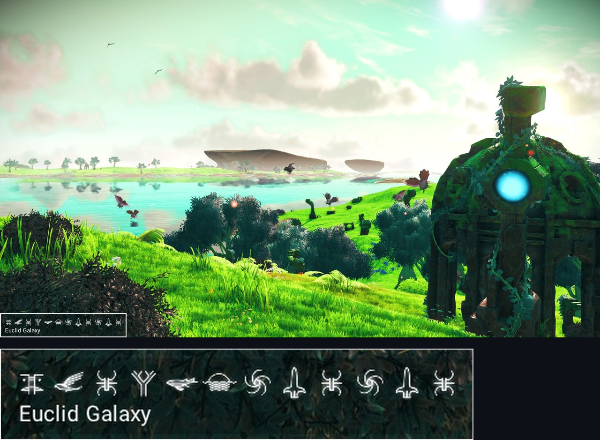

```text
> nms-glyph-reader screenshot.jpg
217EB09D79D7 01D6:002F:01D6:017E Euclid
```

## Usage

### Web

Open [the Glyph Reader page](https://imurashka.github.io/nms-glyph-reader/) in any browser, on a computer or a phone, and drop or paste screenshots on it. The reader runs in the page, so the pictures are not uploaded anywhere. Each one shows the glyph row and the galaxy name it found next to what it read, and the list downloads as TXT, JSON or CSV in the formats below. Each release deploys the page built from it. The page is in `web/`; `sh web/build.sh` builds it into `web/site`.

### Command line

Download the app for your system from [Releases](https://github.com/imurashka/nms-glyph-reader/releases):

<details>
<summary>Windows</summary>

```text
nms-glyph-reader.exe screenshot.jpg
```

You can also drag a screenshot onto `nms-glyph-reader.exe`. A window shows the answer and closes when you press Enter.

</details>

<details>
<summary>macOS (Apple Silicon)</summary>

```text
chmod +x nms-glyph-reader-macos
xattr -c nms-glyph-reader-macos
./nms-glyph-reader-macos screenshot.jpg
```

macOS marks every downloaded file, and it does not run a marked app that Apple has not signed. `xattr -c` removes the mark.

</details>

<details>
<summary>Linux (x86-64)</summary>

```text
chmod +x nms-glyph-reader-linux
./nms-glyph-reader-linux screenshot.jpg
```

</details>

The app prints one line per picture: the address, its galactic coordinates (`XXXX:YYYY:ZZZZ:SSSS`, as the signal booster shows them) and the galaxy. With more than one picture, each line starts with the picture's path:

```text
> nms-glyph-reader 14.jpg 28.jpg 13.jpg
14.jpg: 217EB09D79D7 01D6:002F:01D6:017E Euclid
28.jpg: 14070E45A7B3 0FB2:008D:0C59:0407
13.jpg: no address
```

| Answer | Meaning |
|---|---|
| `217EB09D79D7 01D6:002F:01D6:017E Euclid` | the address, its coordinates and the galaxy |
| `217EB09D79D7 01D6:002F:01D6:017E` | the address and its coordinates; no galaxy name was read |
| `no address, Euclid` | the galaxy; glyphs were found, but the reader is not sure enough of them, or they are not an address the game can open |
| `no address` | neither |
| `cannot open (...)` | the file cannot be read, is not a supported picture, or is over 50 megapixels; the reason is in the brackets |

`-f json` prints one JSON object per line. A missing value is `null`, and `galaxy_number` counts from 1, as the game does:

```text
> nms-glyph-reader -f json 14.jpg 13.jpg none.jpg
{"file":"14.jpg","address":"217EB09D79D7","coords":"01D6:002F:01D6:017E","galaxy":"Euclid","galaxy_number":1}
{"file":"13.jpg","address":null,"coords":null,"galaxy":null,"galaxy_number":null}
{"file":"none.jpg","error":"file not found"}
```

`-f csv` prints a header and one row per picture. A missing value is an empty cell:

```text
> nms-glyph-reader -f csv 14.jpg 28.jpg none.jpg
file,address,coords,galaxy,galaxy_number,error
14.jpg,217EB09D79D7,01D6:002F:01D6:017E,Euclid,1,
28.jpg,14070E45A7B3,0FB2:008D:0C59:0407,,,
none.jpg,,,,,file not found
```

The exit code is 0 when every picture gave an address, 1 when some picture gave none, and 2 when some file could not be opened.

### Rust library

```text
cargo add nms-glyph-reader
```

```rust,no_run
fn main() -> Result<(), Box<dyn std::error::Error>> {
    let bytes = std::fs::read("portal.jpg")?;
    match nms_glyph_reader::read(&bytes) {
        Ok(reading) => {
            if let Some(address) = reading.address {
                println!("address {address}");
            }
            if let Some(galaxy) = reading.galaxy {
                println!("galaxy {galaxy}");
            }
        }
        Err(error) => println!("cannot read: {error}"),
    }
    Ok(())
}
```

## Accuracy

Tested on screenshots from Reddit posts:

| Posts | Screenshots | Right | Wrong | No address |
|---|---:|---:|---:|---:|
| 2025-2026 | 17,576 | 17,510 | 14 | 52 |
| 2017-2024 | 2,000 | 1,990 | 2 | 8 |

Most of the 2025-2026 screenshots were also used for training. None of the 2017-2024 screenshots were.

## How it works

Five steps: cut the screenshot into shapes, find the twelve shapes that are the glyphs, read each glyph, read the galaxy name under them, check the address. `read` in [lib.rs](src/lib.rs) runs them in this order, and each step is one file in [src/steps](src/steps): `shapes.rs`, `rows.rs`, `glyphs.rs`, `galaxy/` and `address.rs`. Decoding and resizing the picture are in [src/picture](src/picture), the net in [src/net](src/net).

**1. Cut into shapes.** A screenshot wider than 1920 pixels is also shrunk to 1920, and both sizes go through steps 1 to 3. Ink is every pixel brighter than a brightness level. There are three levels, and the reader cuts the screenshot once for each level. Touching ink pixels make a shape. This screenshot has 804 shapes at the middle level.

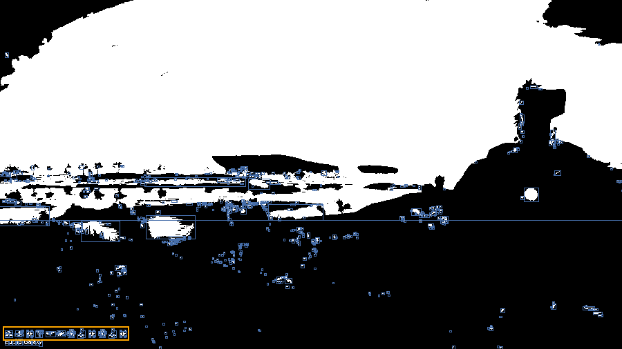

**2. Find the glyphs.** Shapes too big, too small or too thin for a glyph are dropped. The glyphs are twelve shapes of one height on one line at equal spacing, wherever they are on the screen. Shapes of about one height on one line make a band, and a band needs at least ten shapes. Each distance between two neighbouring shapes in the band is tried as the spacing: from one of these shapes, the reader moves left and right by this spacing and marks a place at each move, until it has twelve places. The reader also draws a straight line through the places it found and tries the places on that line. Up to two places may be empty, and the pieces of a broken glyph are joined into one. The box at each place is a cell, and twelve cells make a candidate. At the middle level this screenshot gives 9 candidates, all on the glyphs. On other screenshots, text, menus and fences give candidates too.

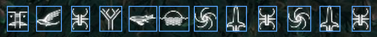

**3. Read each glyph.** A small neural net, hand-written in Rust, reads each cell as one of the sixteen glyphs or "not a glyph". How it was trained is in [Training](#training). When the net is sure that a cell is not a glyph, its candidate is dropped: this drops the text, menus and fences. The most confident candidate wins. Then every ink that found the same twelve places votes on each glyph. When the result fails the check of step 5, the reader adds two more kinds of ink, pixels lighter or darker than the pixels around them, and reads and votes again.

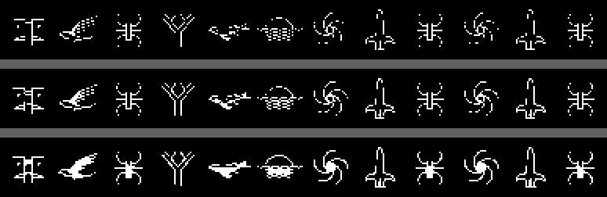

<table>
<tr>
<td>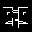</td>
<td>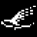</td>
<td>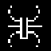</td>
<td>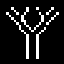</td>
<td>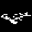</td>
<td>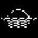</td>
<td>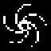</td>
<td>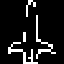</td>
<td></td>
<td>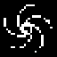</td>
<td>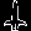</td>
<td>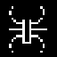</td>
</tr>
<tr>
<td align="center"><code>2</code></td>
<td align="center"><code>1</code></td>
<td align="center"><code>7</code></td>
<td align="center"><code>E</code></td>
<td align="center"><code>B</code></td>
<td align="center"><code>0</code></td>
<td align="center"><code>9</code></td>
<td align="center"><code>D</code></td>
<td align="center"><code>7</code></td>
<td align="center"><code>9</code></td>
<td align="center"><code>D</code></td>
<td align="center"><code>7</code></td>
</tr>
</table>

**4. Read the galaxy.** The reader draws the 256 galaxy names in Roboto, the photo mode font, and the names the first five galaxies take in the nine other languages, and looks for each name on the line under the glyphs, wherever it stands among the words around it. A clear match gives the galaxy. A weaker match gives it only when the whole English label, such as `Euclid Galaxy`, also matches at that place. Otherwise no galaxy is given.

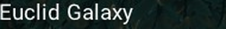 → `Euclid`

**5. Check the address.** The net must be sure enough of every glyph. The address must also be one the game can open: a planet from 0 to 6, a system that exists, and coordinates that exist.

```text
217EB09D79D7 Euclid
```

## Training

To tell which glyph a cell is, I first compared it with pictures of the sixteen glyphs. On the 17,576 screenshots from [Accuracy](#accuracy), this gave about 530 wrong addresses, and the pictures made the exe 3 MB larger. So I trained a small neural net of my own instead. It gets 14 wrong on the same screenshots.

The trainer in `trainer/` has two commands. `train` makes a model from a list of pictures, and `measure` checks a model on another list. `train` takes the number of passes over the pictures as an optional last argument, 10 when it is left out. `measure` without a model checks the built-in one.

```text
cargo run --release -p trainer -- train list.tsv model.bin
cargo run --release -p trainer -- measure test.tsv model.bin
```

The list is a text file with one picture per line and three fields separated by tabs: the path (absolute, or relative to the list's folder), the twelve glyphs or `-` when there are none, and the galaxy or `-`.

```text
shots/portal.jpg	10A3F9556C30	Euclid
shots/catalogue.png	14070E45A7B3	-
shots/freighter.jpg	-	-
```

`train` finds the glyphs on each picture the way the reader does, and teaches the net the listed glyph for each one. Pictures listed with `-` teach it what is not a glyph. A picture is skipped when it cannot be opened, when the reader finds no glyphs on it, or when the glyphs it finds differ from the list in more than two places. `train` also keeps the cut cells in `model.cells` next to the model and reuses them while the list does not change; delete it after changing a picture. To use the model, copy `model.bin` over `src/assets/glyphs.bin` and build again.

`measure` reads every picture of the list. It prints each picture where the answer differs from the list, then the count of each result. Measure on pictures that were not in the training list.

The built-in model was trained in 9 minutes on a desktop CPU, on 15,501 pictures:

- 13,881 screenshots from Reddit posts: 13,526 of 2025-2026 and 355 of 2020-2023. The glyphs come from the post's text when the text agreed with the reader, or from the reader when the reader was sure;
- 210 of my own screenshots;
- 1,410 drawn rows of letters and digits, as examples of what is not a glyph.

The training pictures are not published: most of them are other players' screenshots.

## Contributing

A screenshot the reader gets wrong, or reads nothing from while it shows the glyphs, is the most useful thing to send: open an issue with the **A screenshot read wrong** form and attach the original file. Pull requests are welcome, a better model trained as [Training](#training) shows included.

## Credits

- Roboto font by Google, built into the reader to draw the galaxy names. Apache 2.0, the license is in `src/assets/Roboto-LICENSE.txt`.
- The sixteen glyph pictures in `tests/font` are drawn with the NMS Glyphs font by Stephan van der Feest. The page shows them too.
- The page's lettering is Jost by Indestructible Type and Roboto by Google, both under the SIL Open Font License; the licenses are in `web/brand`.
- The 28 pictures in `tests/pictures` are from players' Reddit posts (each post is linked in `tests/pictures.txt`) and from my own screenshots. If a picture is yours and you want it removed, open an issue.
- The portal glyph art and the galaxy names belong to Hello Games. This project is not affiliated with Hello Games.

## License

MIT, see `LICENSE`.
